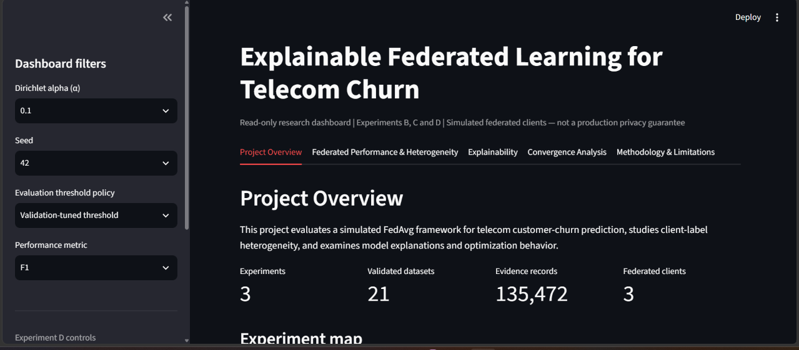
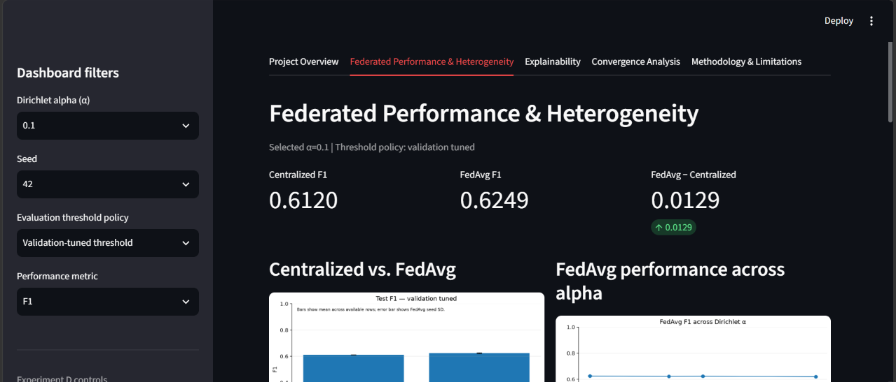
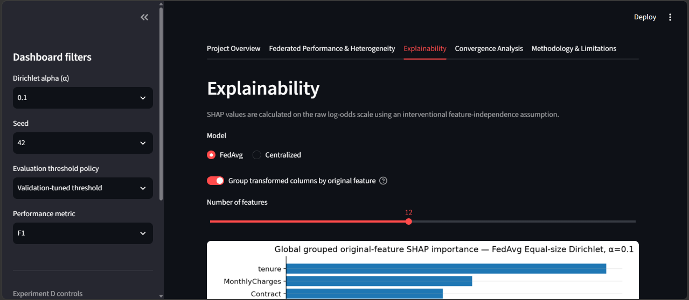
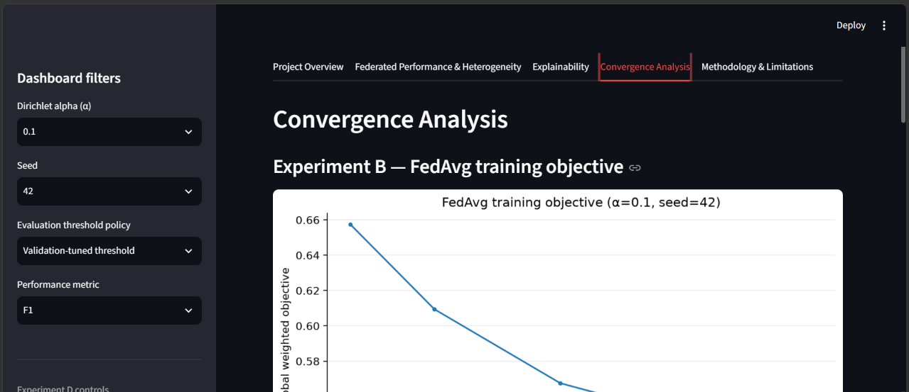
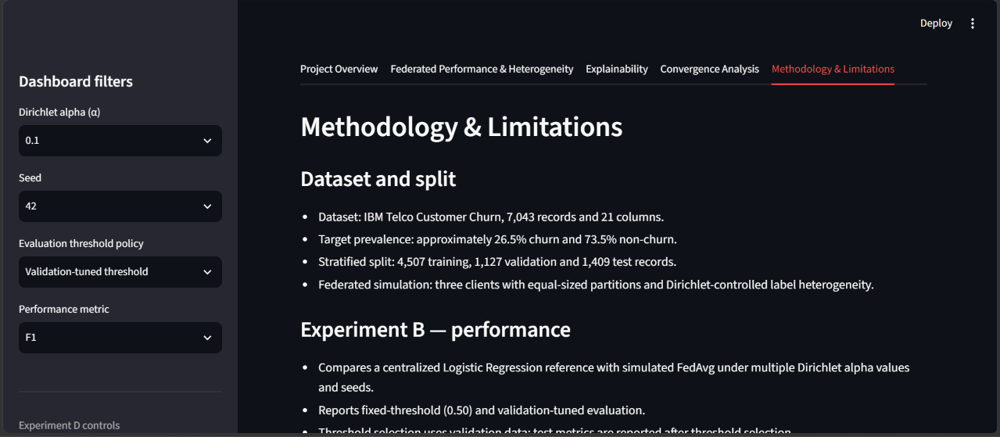

# Explainable Federated Learning Framework for Predicting Customer Churn in Telecom Networks

A research capstone project investigating telecom customer-churn prediction using a simulated Federated Averaging (FedAvg) setup, with an emphasis on predictive performance, client-label heterogeneity, model explainability, and optimization behaviour.

> **Project status:** Experimental implementation and interactive read-only research dashboard  
> **Dataset:** IBM Telco Customer Churn  
> **Learning setup:** Centralized Logistic Regression reference vs. simulated three-client FedAvg  
> **Explainability:** SHAP  
> **Dashboard:** Streamlit

---

## 1. Project Overview

Customer churn is a significant challenge for telecommunications providers. Customers may discontinue a service because of pricing, service quality, usage behaviour, customer support, contract conditions, or changing requirements. Identifying customers who are likely to churn can help providers investigate retention opportunities.

Conventional machine-learning workflows often assume that customer records can be collected in a centralized location. In practical telecom environments, customer data may be distributed across regions, departments, systems, or organizations and may not be suitable for direct sharing.

Federated Learning (FL) provides a collaborative training approach in which participating clients train locally and share model updates rather than directly pooling their raw training records. However, predictive performance alone does not explain why a model makes a particular churn prediction.

This project studies a simulated federated churn-prediction framework and evaluates it from three connected perspectives:

1. **Predictive performance:** How does simulated FedAvg compare with a centralized Logistic Regression reference?
2. **Explainability:** How consistent and interpretable are SHAP explanations for centralized and federated models?
3. **Optimization behaviour:** How do communication rounds and local training epochs affect the federated optimization process?

The project also provides an interactive dashboard for inspecting the generated experimental evidence.

## 2. Problem Statement

Telecom providers need to identify customers who may churn while working with customer information that can be distributed across multiple data-holding units. A centralized model can provide churn predictions, but it does not address the practical constraint that raw customer data may not be suitable for direct sharing. A federated model can support collaborative training without pooling raw client records, but its predictions still need to be understandable.

The central research question is:

**How can telecom customer churn be predicted using decentralized customer data while keeping the data local and still providing understandable explanations for the model's predictions?**

## 3. Project Objectives

The project follows these objectives:

1. Study machine learning, deep learning, Federated Learning, and Explainable AI approaches used for telecom customer-churn prediction.
2. Develop a Federated Learning-based churn-prediction framework in which simulated clients collaboratively train a model while retaining their raw training records locally.
3. Integrate Explainable AI techniques, particularly SHAP, to identify factors influencing churn predictions.
4. Evaluate predictive performance using classification metrics such as accuracy, precision, recall, F1-score, and ROC-AUC.
5. Compare centralized and federated approaches in terms of predictive performance, data locality, and explainability.
6. Investigate whether the resulting explanations provide meaningful churn-related insights.

## 4. Research and Experimental Design

The implementation is organized into three experimental components.

| Experiment | Focus | Main investigation |
|---|---|---|
| **B** | Federated performance and heterogeneity | Compare centralized and FedAvg performance across Dirichlet partition settings and random seeds |
| **C** | Explainability | Analyse SHAP feature importance, seed stability, and agreement between centralized and federated explanations |
| **D** | Optimization and convergence | Study the effects of communication rounds and local epochs on objective values, gradients, model distance, validation loss, and validation AUC |

### 4.1 Dataset

The experiments use the IBM Telco Customer Churn dataset.

- **Records:** 7,043
- **Columns:** 21
- **Target:** `Churn`
- **Class distribution:** approximately 73.5% non-churn and 26.5% churn
- **Dataset source:** [IBM Telco Customer Churn dataset](https://raw.githubusercontent.com/IBM/telco-customer-churn-on-icp4d/master/data/Telco-Customer-Churn.csv)

The stratified data split used in the experiments is:

| Partition | Records |
|---|---:|
| Training | 4,507 |
| Validation | 1,127 |
| Final test | 1,409 |
| **Total** | **7,043** |

The validation partition is used for threshold selection in the threshold-tuned evaluation. The final test partition is kept separate from threshold selection.

### 4.2 Centralized Reference

A centralized Logistic Regression model is used as a reference point for comparison with the simulated federated models.

The recorded centralized baseline metrics include:

| Metric | Recorded value |
|---|---:|
| Accuracy | 0.7381 |
| Precision | 0.5043 |
| Recall | 0.7834 |
| F1-score | 0.6136 |
| ROC-AUC | 0.8413 |

These values are from the recorded centralized baseline training output. Experiment B also reports its own threshold-specific centralized and FedAvg comparisons; those results should be interpreted using the corresponding evaluation policy rather than mixed with this baseline output.

### 4.3 Simulated Federated Learning

The federated experiments use three simulated clients. Each client receives a partition of the training data and participates in collaborative training using Federated Averaging (FedAvg).

The non-IID partitioning experiment uses Dirichlet-controlled label heterogeneity. The tested alpha values are `0.1`, `0.5`, `1.0`, and `10.0`.

Five random seeds are used in Experiment B: `42`, `43`, `44`, `45`, and `46`.

The client partitions in the equal-size experiment are approximately balanced in record count. Equal client sizes do not imply equal class distributions.

**Important scope qualification:** These are simulated clients operating on one research dataset. The implementation demonstrates a federated training workflow; it does not establish production deployment, secure aggregation, differential privacy, or a formal privacy guarantee.

---

## 5. Experiment B — Federated Performance and Heterogeneity

### 5.1 Purpose

Experiment B compares a centralized Logistic Regression reference with simulated FedAvg models under different Dirichlet label-distribution settings.

The experiment examines predictive metrics across alpha values and random seeds, fixed-threshold and validation-tuned evaluation, client label heterogeneity, client partition-size balance, and paired bootstrap uncertainty for F1-score differences.

### 5.2 Evaluation policies

Two threshold policies are considered:

1. **Fixed threshold:** probability threshold of `0.50`.
2. **Validation-tuned threshold:** threshold selected using validation data, then applied to the final test predictions.

The two policies answer different evaluation questions and should not be mixed.

For centralized Logistic Regression, the Dirichlet alpha parameter is not applicable. Its alpha value is therefore represented as missing in the relevant evidence tables. This is expected and is not a missing federated configuration.

### 5.3 Recorded findings

The following findings are based on the Experiment B evidence inspected during development:

- Under validation-tuned evaluation, the centralized reference has an F1-score of approximately **0.6120**.
- The observed FedAvg validation-tuned F1 values across the tested alpha settings are approximately **0.61947–0.62489**, depending on configuration and seed.
- Under fixed-threshold evaluation, the centralized F1-score is approximately **0.619895**.
- The observed FedAvg fixed-threshold F1 values are approximately **0.60345–0.60381**.
- The centralized ROC-AUC is approximately **0.8417** in this experiment and is higher than the corresponding FedAvg results by approximately **0.0068–0.0069**.
- Client label heterogeneity is not strictly monotonic across the tested alpha values in the finite set of five random seeds. The observed weighted label-distribution standard deviations were approximately 0.0887 (`alpha=10`), 0.1943 (`alpha=1`), 0.1710 (`alpha=0.5`), and 0.2152 (`alpha=0.1`).
- The client partition-size coefficient of variation is approximately **0.000314**, indicating nearly equal client record counts in this experiment.

These are experiment-specific observations, not universal properties of FedAvg.

### 5.4 Bootstrap analysis

Paired bootstrap analysis was performed using 10,000 resamples, stratified by test class and resampling FedAvg seeds/test records.

The inspected confidence intervals for tuned F1 differences included zero across the tested alpha settings. Therefore, the evidence does not establish a statistically clear tuned-F1 advantage for FedAvg over the centralized reference.

A fraction of bootstrap differences above zero is a descriptive bootstrap statistic. It must **not** be presented as a p-value or as the probability that one model is truly superior.

### 5.5 Interpretation

The experiment does not support a general claim that federated learning outperforms centralized learning. Its contribution is the systematic comparison across heterogeneous client partitions, evaluation policies, and random seeds, including uncertainty analysis.

---

## 6. Experiment C — Explainability with SHAP

### 6.1 Purpose

Experiment C investigates whether the federated model's predictions can be interpreted and how its explanations compare with those from the centralized reference.

The analysis includes global feature importance, grouped importance for original features, explanation stability across federated seeds, agreement between centralized and federated explanations, and illustrative individual prediction explanations.

### 6.2 SHAP methodology

SHAP values are computed for the linear models on the **raw log-odds scale** using an interventional feature-independence assumption.

The inspected implementation uses a background sample of 100 training records, eight individual test examples for illustrative local explanations, mean absolute SHAP values for descriptive global importance, and grouping of transformed columns by their original feature for a more readable feature-level summary.

Grouping transformed columns means that contributions from transformed columns are aggregated by original feature. It is **not** equivalent to computing coalition-level SHAP values for groups of dependent features.

### 6.3 Implementation checks

The following numerical checks were recorded:

| Check | Recorded result |
|---|---:|
| Maximum absolute difference in SHAP library cross-check | 0 |
| Maximum SHAP additivity error | \(1.776 \times 10^{-15}\) |
| Maximum prediction-match difference | \(1.11 \times 10^{-16}\) |

These checks support numerical consistency of the implemented SHAP calculation for the tested cases. They do not remove the methodological assumptions of the explanation method.

### 6.4 Explanation agreement and stability

Across the five inspected seeds:

- Transformed-feature explanation agreement, measured using Spearman correlation, was approximately **0.464**.
- Grouped original-feature agreement was approximately **0.47**.
- Top-10 feature overlap was approximately **70%**.
- FedAvg explanation stability across seeds was close to 1.0 in the inspected stability analysis.

High stability among FedAvg seeds does not imply high agreement with the centralized model. These are different comparisons and should be interpreted separately.

### 6.5 Scope and limitations

- The feature-independence assumption can be unrealistic when telecom variables are correlated.
- Transformed columns are perturbed independently under the implemented analytical setup.
- Grouped contributions are sums of transformed-column SHAP values, not coalition-level grouped SHAP.
- Global mean absolute SHAP values are descriptive and are computed on the test set.
- The individual examples are illustrative and should not be interpreted as a complete customer-level validation study.
- Experiment C explains the 12-round, three-local-epoch FedAvg models used in that experiment. It does not explain the longer-run configurations evaluated in Experiment D.

---

## 7. Experiment D — Optimization and Convergence Analysis

### 7.1 Purpose

Experiment D investigates how communication rounds and local training epochs affect the optimization behaviour of the simulated FedAvg process.

The experiment evaluates five configurations:

| Configuration | Communication rounds | Local epochs |
|---|---:|---:|
| `R12_E3` | 12 | 3 |
| `R50_E3` | 50 | 3 |
| `R100_E3` | 100 | 3 |
| `R50_E1` | 50 | 1 |
| `R50_E5` | 50 | 5 |

The inspected experiment contains **100 runs**, **20 partition diagnostic records**, and **5,240 round-history records**.

### 7.2 Optimization setup

The inspected implementation uses full-batch local gradient descent. `local_epochs` therefore counts full local-data gradient steps.

The centralized reference objective and optimization settings recorded for this experiment are:

| Item | Value |
|---|---:|
| Centralized reference objective | 0.48311385 |
| Centralized reference gradient L2 norm | \(5.76 \times 10^{-8}\) |
| Centralized validation log-loss | 0.48249547 |
| Centralized validation ROC-AUC | 0.8478786 |
| Iterations | 124 |
| Maximum-iteration limit reached | No |
| Regularization parameter C | 0.221877 |
| L2 regularization coefficient | 0.001 |
| Learning rate | 0.08 |

### 7.3 Mean results by configuration

The following are the recorded mean values across runs for each configuration:

| Configuration | Objective | Gradient L2 | Objective gap | Coefficient distance | Validation log-loss | Validation ROC-AUC |
|---|---:|---:|---:|---:|---:|---:|
| R12_E3 | 0.528463 | 0.129698 | 0.045349 | 1.755271 | 0.538734 | 0.841117 |
| R50_E3 | 0.492655 | 0.030307 | 0.009541 | 1.523880 | 0.489367 | 0.845748 |
| R100_E3 | 0.487981 | 0.015616 | 0.004867 | 1.412575 | 0.483766 | 0.846648 |
| R50_E1 | 0.513402 | 0.091849 | 0.030288 | 1.693020 | 0.520421 | 0.842434 |
| R50_E5 | 0.489174 | 0.021156 | 0.006060 | 1.446015 | 0.484232 | 0.846524 |

### 7.4 Interpretation

In the recorded runs:

- Increasing communication rounds from 12 to 50 and 100 with three local epochs reduced the mean objective gap and gradient norm.
- The 100-round, three-local-epoch configuration had the smallest mean objective gap and gradient norm among the listed configurations.
- At 50 rounds, changing the number of local epochs changed the optimization behaviour and validation metrics.
- Validation ROC-AUC is not required to be monotonic across optimization rounds or configurations.
- The experiment did not use the final test set; its reported validation metrics are not final test performance.

These observations describe the inspected experimental configurations. They should not be generalized into a theoretical convergence guarantee for FedAvg.

---

## 8. System Architecture

The project is organized into an experimental pipeline and a read-only inspection dashboard.

```text
IBM Telco Customer Churn Dataset
              |
              v
     Data preparation and split
              |
       +------+------+
       |             |
       v             v
Centralized       Client data
Logistic          partitioning
Regression            |
reference              v
                 Simulated clients
                       |
                       v
                 Local training
                       |
                       v
                  FedAvg rounds
                       |
              +--------+--------+
              |                 |
              v                 v
       Experiment B/C      Experiment D
       performance and    optimization and
       explainability     convergence analysis
              |                 |
              +--------+--------+
                       |
                       v
             CSV experimental evidence
                       |
                       v
             data_loader.py validation
                       |
                       v
              visualizations.py
                       |
                       v
                 app.py
                       |
                       v
             Read-only Streamlit UI
```

### Main implementation modules

| Module / component | Responsibility |
|---|---|
| `app.py` | Streamlit dashboard and interactive evidence inspection |
| `data_loader.py` | Loads and validates the experiment evidence |
| `visualizations.py` | Produces Matplotlib figures from loaded evidence |
| `tests/test_data_loader.py` | Automated tests for evidence loading and validation |
| Experiment scripts | Generate the experimental evidence used by the dashboard |
| Experiment output directories | Store the CSV evidence for Experiments B, C, and D |

The dashboard is designed for inspection. It does not expose experiment-training controls and does not launch training scripts.

## 9. Dashboard

The Streamlit application provides five sections:

1. **Project Overview** — project summary, experiment map, and evidence inventory.
2. **Federated Performance & Heterogeneity** — centralized/FedAvg comparisons, alpha analysis, and client heterogeneity.
3. **Explainability** — SHAP global importance, grouping controls, and explanation comparisons.
4. **Convergence Analysis** — Experiment B training objective and Experiment D optimization histories.
5. **Methodology & Limitations** — dataset, split, experimental design, assumptions, and limitations.

### Dashboard screenshots

The following are screenshots captured from the implemented Streamlit dashboard. They show the actual application interface and its rendered experimental views, rather than illustrative mockups.

#### Project overview



#### Federated performance and heterogeneity



#### Explainability



#### Convergence analysis



#### Methodology and limitations



The Streamlit application provides five sections:

1. **Project Overview** — project summary, experiment map, and evidence inventory.
2. **Federated Performance & Heterogeneity** — centralized/FedAvg comparisons, alpha analysis, and client heterogeneity.
3. **Explainability** — SHAP global importance, grouping controls, and explanation comparisons.
4. **Convergence Analysis** — Experiment B training objective and Experiment D optimization histories.
5. **Methodology & Limitations** — dataset, split, experimental design, assumptions, and limitations.

The sidebar provides controls for the available experiment filters, including Dirichlet alpha, seed, threshold policy, performance metric, and Experiment D configuration/seed.

### Run the dashboard

From the project root, activate the project's virtual environment and run:

```bash
streamlit run app.py
```

The dashboard reads the existing evidence files. It is not intended to retrain models or overwrite experimental outputs.

---

## 10. Installation and Environment

The development environment used during implementation was:

- Python 3.11.9
- Pandas 3.0.6
- NumPy 2.4.6
- scikit-learn 1.9.1
- Matplotlib 3.11.2
- Streamlit 1.65.0

These are the observed development versions, not a claim that every other version is incompatible.

### Windows PowerShell setup

```powershell
python -m venv .venv
.venv\Scripts\Activate.ps1
```

Install the project's dependencies using its dependency file:

```powershell
pip install -r requirements.txt
```

Launch the dashboard:

```powershell
streamlit run app.py
```

Run the data-loader tests:

```powershell
python -m unittest discover -s tests -v
```

The recorded test run completed with **9 tests passing**.

> If PowerShell blocks virtual-environment activation, use the appropriate execution-policy procedure for your machine or invoke the environment's Python executable directly. Do not change project dependencies solely to resolve an environment-specific shell issue.

---

## 11. Evidence Inventory and Validation

The dashboard's evidence loader was validated against the available experiment outputs.

| Experiment | Validated datasets | Evidence records |
|---|---:|---:|
| Experiment B | 9 | 120,383 |
| Experiment C | 9 | 10,590 |
| Experiment D | 3 | 5,360 |
| **Total** | **21** | **135,472** |

The data-loader validation reported:

```text
ALL EXPERIMENTS VALIDATED
```

The automated test suite reported:

```text
Ran 9 tests
OK
```

The visualization smoke test successfully created **10 figures**.

These checks validate the inspected evidence-loading, test, and plotting paths. They do not replace a complete scientific reproduction of every experiment from a clean environment.

## 12. Limitations

The following limitations are important when interpreting the results:

1. **Simulated federated environment:** The clients are simulated using partitions of one dataset. This is not a deployment across independent telecom organizations.
2. **No formal privacy guarantee:** Keeping raw records within simulated client partitions does not by itself establish differential privacy, secure aggregation, or protection against inference attacks.
3. **Single dataset:** The experiments use the IBM Telco Customer Churn dataset. Results may not generalize to other telecom providers, regions, or time periods.
4. **Finite random seeds:** Five seeds in Experiment B and C provide useful repeated observations but do not cover every possible partition or training outcome.
5. **SHAP assumptions:** The interventional feature-independence assumption may not reflect dependencies between telecom features.
6. **Grouped SHAP interpretation:** Summing transformed-column contributions is a reporting aggregation, not coalition-level grouped SHAP.
7. **Experiment scope differs:** Experiment C explains its 12-round, three-local-epoch models; Experiment D evaluates additional optimization configurations.
8. **Validation versus test:** Experiment D reports validation metrics and does not use the final test set. Its validation results must not be presented as test results.
9. **No established FedAvg convergence theorem:** The observed optimization trends are empirical findings for the tested setup, not a theoretical convergence guarantee.
10. **No proven federated superiority:** The evidence does not establish that FedAvg consistently outperforms centralized Logistic Regression.

## 13. Future Work

Potential extensions include:

- Evaluate the framework on additional telecom churn datasets.
- Increase the number of random seeds and test additional non-IID partition settings.
- Evaluate more client counts and unequal client-size scenarios.
- Investigate secure aggregation and differential privacy as separate, measurable mechanisms.
- Study feature-dependence-aware explanation methods and more rigorous grouped-feature explanations.
- Evaluate explanation fidelity, stability, and agreement using additional quantitative measures.
- Investigate temporal validation and distribution shift.
- Evaluate communication cost and client-level resource requirements.
- Extend the evaluation to additional model families while maintaining controlled comparisons.

These are proposed directions, not completed features.

## 14. Reproducibility and Research Integrity

The dashboard is intended to inspect existing experiment evidence without changing it. The experiment output directories and dataset are treated as evidence artifacts.

For a reproducible research submission:

- Preserve the original experiment outputs.
- Record the exact Python and dependency versions.
- Keep random seeds and partition configurations with each result.
- Distinguish validation metrics from final test metrics.
- Report uncertainty alongside point estimates where available.
- Avoid interpreting descriptive bootstrap fractions as p-values.
- Do not claim privacy guarantees without implementing and evaluating the relevant privacy mechanisms.
- Do not claim federated superiority unless supported by the experimental design and statistical evidence.

## 15. Project Structure

The dashboard and supporting modules are expected at the project root:

```text
telecom_churn_capstone/
│
├── app.py
├── data_loader.py
├── visualizations.py
├── requirements.txt
├── README.md
│
├── tests/
│   └── test_data_loader.py
│
├── data/
│
├── noniid_equal_size_outputs_run2/
├── explainability_experiment_C_outputs/
├── experiment_D_v5_outputs/
│
└── other experiment scripts and evidence directories
```

This is a documentation view of the principal files and evidence locations discussed during development. Retain the actual existing experiment scripts and output directories in your repository; do not rename or replace them merely to match this illustrative tree.

## 16. Acknowledgements

- **Dataset:** IBM Telco Customer Churn dataset.
- **Research area:** Federated Learning, Explainable AI, and telecom customer-churn prediction.
- **Core methods:** Logistic Regression, Federated Averaging (FedAvg), and SHAP.

---

**Project:** Explainable Federated Learning Framework for Predicting Customer Churn in Telecom Networks  
**Project type:** B.Tech Computer Science Engineering Capstone  
**Purpose:** Academic research and experimental evaluation
