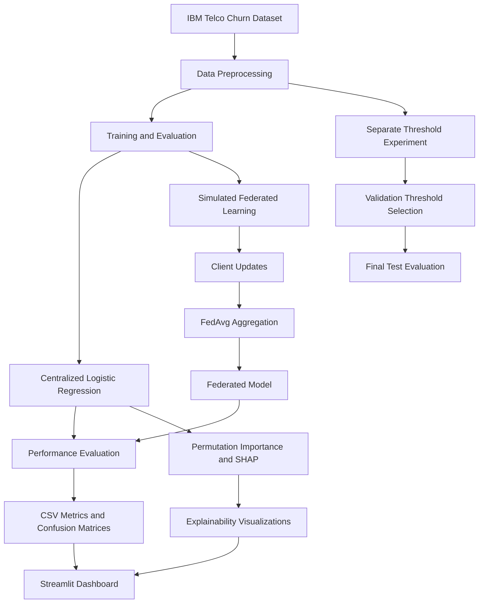

# 🧠 Explainable Federated Learning for Telecom Customer Churn

### An ML capstone project combining churn prediction, simulated federated learning, and Explainable AI.

<p align="center">
  
  
  
  
  
</p>

---

## 🚀 About the Project

Customer churn is an important challenge for telecommunications companies. Identifying customers who are likely to leave can help businesses understand customer behavior and plan retention strategies.

This project develops a machine learning prototype to predict telecom customer churn and compare two approaches:

- **Centralized Learning:** Train a Logistic Regression model on centralized data.
- **Federated Learning:** Simulate three clients and aggregate model parameters using Federated Averaging (FedAvg).
- **Explainable AI:** Use permutation importance and SHAP to investigate which features influence predictions.
- **Threshold Optimization:** Study how classification thresholds affect churn detection and model performance.

> **Project status:** Core models, SHAP analysis, a Streamlit dashboard, and a separate threshold-validation experiment have been implemented. Real-world federated deployment and formal privacy mechanisms remain future work.

## 📑 Table of Contents

- [Project Highlights](#-project-highlights)
- [Dataset](#-dataset)
- [System Workflow](#-system-workflow)
- [Model Performance](#-model-performance)
- [Threshold Experiment](#-threshold-experiment)
- [Explainable AI](#-explainable-ai)
- [Project Structure](#-project-structure)
- [Installation and Usage](#-installation-and-usage)
- [Limitations](#-limitations)
- [Future Work](#-future-work)

## ✨ Project Highlights

<details>
<summary><strong>📊 Customer Churn Prediction</strong></summary>

- Public IBM Telco Customer Churn dataset.
- 7,043 customer records and 21 original columns.
- Centralized Logistic Regression baseline.
- Evaluation using accuracy, precision, recall, F1-score, and ROC-AUC.

</details>

<details>
<summary><strong>🌐 Simulated Federated Learning</strong></summary>

- Three simulated clients.
- Custom FedAvg training workflow.
- Twelve communication rounds.
- Sample-count-weighted parameter aggregation.
- Comparison with the centralized model.

The clients are simulated on one computer; they are not independent telecom servers.

</details>

<details>
<summary><strong>🔍 Explainable AI</strong></summary>

- Permutation feature importance.
- Global SHAP feature importance.
- Individual prediction explanations.
- Visual outputs saved as CSV and PNG files.

SHAP explanations are currently generated for the centralized model only.

</details>

<details>
<summary><strong>🎯 Classification Threshold Analysis</strong></summary>

A separate experiment selects thresholds using validation data and evaluates them on an untouched final test partition.

The aim is to study the trade-off between detecting more churners and generating additional false positives.

</details>

## 📁 Dataset

**Source:** [IBM Telco Customer Churn Dataset](https://raw.githubusercontent.com/IBM/telco-customer-churn-on-icp4d/master/data/Telco-Customer-Churn.csv)

| Property | Details |
|---|---|
| Records | 7,043 |
| Original columns | 21 |
| Target | `Churn` |
| Classes | `Yes`, `No` |
| File location | Repository root |
| Filename | `Telco-Customer-Churn.csv` |

The dataset includes customer account information, subscribed services, billing details, and churn status. `customerID` is excluded from model features, and `TotalCharges` is converted to numeric format during preprocessing.

This is a public dataset for experimentation; the project does not establish that it contains current, live telecom customer records.

## 🔄 System Workflow



## 📈 Model Performance

### Experiment 1 — Original Baseline

Results from the original held-out test split:

| Metric | Centralized Logistic Regression | Simulated FedAvg |
|---|---:|---:|
| Accuracy | 73.81% | 77.86% |
| Precision | 50.43% | 74.22% |
| Recall | 78.34% | 25.40% |
| F1-score | 61.36% | 37.85% |
| ROC-AUC | 84.13% | 83.63% |

### 💡 What do these results mean?

- **Accuracy:** FedAvg achieved higher overall accuracy in this experiment.
- **Precision:** FedAvg had higher precision at the default threshold.
- **Recall:** The centralized model detected a larger proportion of actual churn cases.
- **F1-score:** The centralized model performed better when balancing precision and recall.
- **ROC-AUC:** The two models showed similar ranking performance.

Higher accuracy alone does not mean a model is better at identifying churners. Recall and F1-score are particularly relevant when missed churn cases are costly.

## 🎯 Threshold Experiment

A separate experiment used 4,507 training records, 1,127 validation records, and 1,409 final test records.

The classification thresholds were selected on validation data to maximize F1-score among the tested thresholds.

| Model | Threshold | Accuracy | Precision | Recall | F1-score | ROC-AUC |
|---|---:|---:|---:|---:|---:|---:|
| Centralized | 0.50 | 74.17% | 50.86% | 78.88% | 61.84% | 84.21% |
| Centralized | 0.62 | 77.08% | 55.44% | 69.52% | 61.68% | 84.21% |
| FedAvg | 0.50 | 77.71% | 73.44% | 25.13% | 37.45% | 83.62% |
| FedAvg | 0.33 | 75.23% | 52.34% | 74.87% | 61.61% | 83.62% |

### 📌 Key observation

For FedAvg, reducing the threshold from **0.50 to 0.33**:

- Increased recall from **25.13% to 74.87%**.
- Increased F1-score from **37.45% to 61.61%**.
- Reduced precision from **73.44% to 52.34%**.
- Reduced accuracy from **77.71% to 75.23%**.

This demonstrates a trade-off: detecting more churners also results in more false-positive predictions.

ROC-AUC stays unchanged for each model because adjusting the classification threshold does not change the ranking of its prediction scores.

<details>
<summary><strong>⚠️ How should the results be compared?</strong></summary>

The original baseline and threshold-validation experiment use different train-test splits. Their metrics should be interpreted as separate experiments, not as a direct before-and-after comparison.

The threshold experiment selects thresholds using validation data and evaluates the chosen thresholds on the final test partition.

</details>

## 🔎 Explainable AI

The global SHAP analysis identified the following among the most influential features for the centralized model:

1. `tenure`
2. `MonthlyCharges`
3. `TotalCharges`
4. `InternetService_Fiber optic`
5. `Contract_Month-to-month`

These rankings describe how the trained model uses the features; they do not establish causation.

The repository's `Output/` folder contains the generated explainability artifacts, including:

- `shap_global_importance.png`
- `shap_global_importance.csv`
- `shap_individual_explanation.png`
- `shap_individual_explanation.csv`
- `feature_importance.png`
- `confusion_matrices.png`

## 🗂️ Project Structure

```text
Explainable-federated-learning-telecom-churn/
├── app.py
├── train.py
├── train_with_shap.py
├── threshold_validation_experiment.py
├── requirements.txt
├── README.md
├── .gitignore
├── Telco-Customer-Churn.csv
├── Capstone_Phase_II_Progress_Report.docx
├── Capstone_Report(till phase 3 ).pdf
└── Output/
    ├── model_comparison.csv
    ├── confusion_matrices.png
    ├── feature_importance.csv
    ├── feature_importance.png
    ├── shap_global_importance.csv
    ├── shap_global_importance.png
    ├── shap_individual_explanation.csv
    ├── shap_individual_explanation.png
    ├── central_validation_thresholds.csv
    ├── fedavg_validation_thresholds.csv
    ├── test_threshold_comparison.csv
    ├── test_confusion_matrices.csv
    └── ...
```

This is a representative structure based on the current repository screenshots. Check exact filenames before relying on this listing.

## 🛠️ Installation and Usage

### 1. Clone the repository

```bash
git clone <YOUR_GITHUB_REPOSITORY_URL>
cd Explainable-federated-learning-telecom-churn
```

Replace the placeholder with the actual GitHub URL.

### 2. Create a virtual environment

**Windows PowerShell:**

```powershell
python -m venv .venv
.\.venv\Scripts\Activate.ps1
```

### 3. Install dependencies

```bash
python -m pip install -r requirements.txt
```

### 4. Verify the dataset location

Keep the dataset in the repository root:

```text
Telco-Customer-Churn.csv
```

Ensure that all three scripts—`train.py`, `train_with_shap.py`, and `threshold_validation_experiment.py`—load the CSV from this root location.

### 5. Run the experiments

**Original baseline:**

```bash
python train.py
```

**Model evaluation and SHAP:**

```bash
python train_with_shap.py
```

**Threshold-validation experiment:**

```bash
python threshold_validation_experiment.py
```

### 6. Launch the dashboard

```bash
python -m streamlit run app.py
```

The dashboard displays the functionality implemented in the current version of `app.py`. Threshold-experiment results are part of the dashboard only if the app explicitly loads and displays them.

## ⚠️ Limitations

- Federated clients are simulated on a single computer.
- Secure aggregation and differential privacy are not implemented.
- The original baseline fits preprocessing transformations before splitting the training data among simulated clients.
- Centralized and federated training procedures are not perfectly controlled for a strict scientific comparison.
- Repeated-seed and broader robustness testing remain future work.
- Thresholds may not generalize to other datasets or deployment populations.
- SHAP explanations currently cover the centralized model only.
- No production deployment or real-world churn reduction has been demonstrated.

## 🚀 Future Work

- Run experiments across multiple random seeds.
- Evaluate realistic non-IID client data partitions.
- Improve the comparability of centralized and federated training.
- Explore secure aggregation and differential privacy.
- Investigate explainability approaches for federated models.
- Test on additional datasets.
- Evaluate how predictions could support customer-retention decisions.

These are proposed extensions, not completed features.

## 💻 Technologies

`Python` · `pandas` · `NumPy` · `scikit-learn` · `SHAP` · `Matplotlib` · `Streamlit`

## 🎓 Academic Project

**Project:** Explainable Federated Learning Framework for Predicting Customer Churn in Telecom Networks  
**Degree:** B.Tech Computer Science Engineering  
**Type:** Academic capstone project

---

<p align="center">
  <i>Exploring the balance between predictive performance, model interpretability, and federated learning.</i>
</p>
